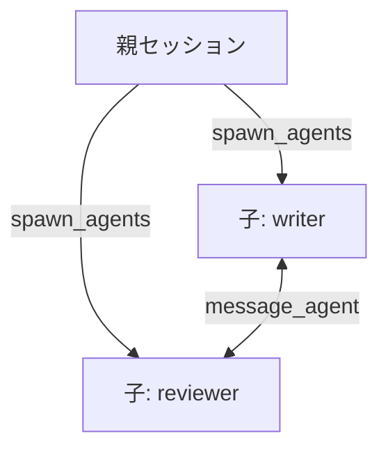

# pi-spawn

Pi から子エージェントを並列に起動し、子同士が直接メッセージをやり取りできる拡張です。

## 概要

独立したサブタスクを1つの会話で順に処理すると、会話が長くなり、作業は直列になります。pi-spawn は、サブタスクを子エージェントへ並列に委譲し、結果だけを親に返します。子は既定で親の会話を引き継がず、子の定義とタスク文だけで動きます。



| 用語 | 意味 |
|---|---|
| 親セッション | いまの Pi セッション。`spawn_agents` で子を起動し、全子の結果を受け取る |
| 子セッション | 親から委譲された1つのタスクを、子の定義に従って実行する |
| 兄弟 | 同じ `spawn_agents` 呼び出しで起動された子同士。`message_agent` で直接連絡できる |

`spawn_agents` は同期的なツール呼び出しです。親のターンは、全子と、兄弟からのメッセージで始まったターンが終わるまで続きます。子をバックグラウンドで走らせることはできません。

## 使い方

### 1. 子の定義を作る

`~/.pi/agent/agents/reviewer.md` を作ります。

```markdown
---
name: reviewer
description: ドキュメントのレビュー役
---

あなたはレビュアーです。指摘は根拠とセットで返してください。
```

定義の書き方は[子の定義](#子の定義)を参照してください。

### 2. 子を起動する

モデルが必要と判断すると、次の形で `spawn_agents` を呼びます。

```text
spawn_agents({
  tasks: [
    { agent: "writer", task: "構成案を書いて", name: "outline" },
    { agent: "reviewer", task: "構成案をレビューして", name: "review" }
  ]
})
```

| 引数 | 必須 | 既定 | 意味 |
|---|---|---|---|
| `tasks` | ○ | — | 並列に走らせるタスク（1件以上） |
| `tasks[].agent` | ○ | — | 子の定義の `name` |
| `tasks[].task` | ○ | — | 子に渡すタスク文 |
| `tasks[].name` | | agent 名 | 進捗と結果に出す表示名。同じ agent を複数起動すると `writer-1`、`writer-2` のように連番になる |
| `tasks[].model` | | 定義の `model`、無ければ親のモデル | 使うモデル（`provider/id`） |
| `tasks[].cwd` | | 親と同じ | 子の作業ディレクトリ |
| `tasks[].resume_session_id` | | — | 再開する子の session id |
| `tasks[].resume_entry_id` | | — | 再開位置の entry id。`resume_session_id` と必ずセットで指定する |

### 3. 兄弟同士で連絡させる

同じ呼び出しに兄弟がいる子のタスク文の先頭には、宛先の一覧が自動で付きます。子はその一覧を使って `message_agent` で連絡します。連絡の仕方をタスク文で指示することもできます。

```text
spawn_agents({
  tasks: [
    { agent: "writer", task: "下書きを書いて。不明点は reviewer に message_agent で質問すること" },
    { agent: "reviewer", task: "構成案をレビューして" }
  ]
})
```

### 4. 続きから再開する

結果の `session_id` と `entry_id` を次の呼び出しに渡すと、その子の続きから実行します。

```text
spawn_agents({
  tasks: [{
    agent: "reviewer",
    task: "指摘を反映した版を再レビューして",
    resume_session_id: "a1b2c3d4",
    resume_entry_id: "e5f6a7b8"
  }]
})
```

## インストール

| 項目 | 条件 |
|---|---|
| Pi | 1.0.3 で検証。他のバージョンは未検証 |
| Node.js | 22.19.0 以上 |

GitHub からインストールします。

```bash
pi install git:github.com/kurowashi/pi-spawn
```

ref を固定する場合は `pi install git:github.com/kurowashi/pi-spawn@<tag|commit>` とします。

ローカルの作業コピーからインストールする場合は、そのパスを指定します。

```bash
pi install /path/to/pi-spawn
```

インストール後は Pi を再起動してください。

## 設定

設定は2種類です。子の定義（`agents/*.md`）と、呼び出しの制限時間（`spawn.json`）です。

### 子の定義

定義は `agents/*.md` に書きます。ファイル名は任意です。呼び出し名は frontmatter の `name` です。

| 場所 | 用途 | 読む条件 |
|---|---|---|
| `<project>/.pi/agents/*.md` | プロジェクト固有の定義 | プロジェクトが trust 済みのとき |
| `~/.pi/agent/agents/*.md` | 全プロジェクト共通の定義 | 常に（`PI_CODING_AGENT_DIR` を設定しているときはその下） |

プロジェクトの trust は、起動時の `--approve` か `/trust` で与えます。

- 同じ `name` の定義が複数あるときは、プロジェクト側が優先されます
- 同じ場所では、ファイル名の昇順で最初の1件だけが有効です
- `name` のない定義は読み飛ばします

frontmatter の項目は次のとおりです。

| キー | 既定 | 意味 |
|---|---|---|
| `name` | 必須 | 呼び出し名 |
| `description` | 空 | 子を選ぶときにモデルへ渡す説明 |
| `tools` | 下記 | 子が使えるツール |
| `model` | 親のモデル | 使うモデル（`provider/id`） |
| `thinking` | Pi の既定 | 推論強度（`off` / `minimal` / `low` / `medium` / `high` / `xhigh` / `max`） |
| `systemPromptMode` | `append` | `append` は Pi の既定のプロンプトの後ろに本文を追加し、`replace` は本文だけにする |
| `inheritProjectContext` | `true` | プロジェクトの context file（AGENTS.md など）を子に渡す |
| `inheritSkills` | `true` | skills を子に渡す |
| `inheritConversation` | `false` | 親の現在の会話を複製して子を始める |
| `extensions` | `false` | 設定済みの拡張を子でも読み込む |

定義の本文（frontmatter の後ろ）が子の追加プロンプトになります。`systemPromptMode: replace` のときは本文だけがプロンプトになります。

`tools` の扱いは次のとおりです。

- 無指定: Pi の既定の有効ツール（通常は `read` / `bash` / `edit` / `write`）と `message_agent`
- 空（`tools: ""` または `tools: []`）: `message_agent` だけ
- 指定: 指定したツールと `message_agent`。子が持たないツール名は無視する

`extensions: true` の子は、設定済みの拡張を読み込み、MCP・codemode・tool_search を使えます。pi-spawn が読み込まれた子は、`spawn_agents` も使えます。

`inheritConversation: true` の子は、親の現在の枝の会話を複製した状態から始めます。モデルは呼び出しごとにこの設定を変えられません。

未知のキーと不正な値は無視します。たとえば `thinking` に未知の値を書くと、その項目は Pi の既定になります。警告は表示されません。`systemPromptMode` の不正な値は `append` として扱います。

定義の変更は、次に子を起動するときから反映されます。定義の一覧は、親のシステムプロンプトに `agents: <name> — <description>` の形で載ります。

### 呼び出しの制限時間

`spawn_agents` の1回の呼び出し全体に制限時間があります。設定は `spawn.json` で行います。

| 場所 | 読む条件 |
|---|---|
| `~/.pi/agent/spawn.json`（`PI_CODING_AGENT_DIR` を設定しているときはその下） | 常に |
| `<cwd>/.pi/spawn.json` | プロジェクトが trust 済みのとき。値はグローバルの値を上書きする |

```json
{ "timeoutMs": 3600000 }
```

| キー | 既定 | 意味 |
|---|---|---|
| `timeoutMs` | 3600000（60分） | 1回の呼び出し全体の制限時間（ミリ秒）。`0` は無制限 |

- 制限時間を過ぎると、まだ実行中の run を中断し、`timed out after <時間>` のエラーにします。完了していた run の結果は残ります
- `timeoutMs: 0` でも、モデルの応答が止まったときは Pi 本体の `httpIdleTimeoutMs`（既定 300000ms）が検出します
- 不正な値は警告して既定値に戻します。UI のある起動では、警告は `spawn_agents` の初回実行時に一度だけ通知されます。`/spawn status` でも確認できます

## 仕組み

### 実行と待機

- 親は `spawn_agents` の中で、全子と、兄弟からのメッセージで始まったターンの終わりを待ちます
- 子同士は待ちません
- 親のターンを中止すると、子も中断されます
- 子の作業ディレクトリは既定で親と同じです。`tasks[].cwd` で変えられます
- 子の会話は既定で空です。親の会話を引き継ぐのは、定義の `inheritConversation: true` のときだけです
- 子の委譲の深さは既定で1です。子が `spawn_agents` を使えるのは、定義に `extensions: true` を書いたときだけです

### 子セッションの保存

子のセッションは `~/.pi/agent/spawn-sessions/` に保存されます。session id は8桁の16進数です。結果の `session_file` を `pi --session <path>` に渡すと、子の会話を開けます。

### 進捗表示

`spawn_agents` の実行中は、子ごとに1行の進捗を表示します。表示は呼び出し直後に始まり、以後1秒ごとに更新されます。

```text
[writer] session_id=a1b2c3d4 — tool: bash (12s) · provider/id · ctx 12.3k/200k (6%) · $0.0123 · 最新の出力
```

- 活動は `starting`、`thinking`、`writing`、`tool: <name>`、`done` のいずれかです
- `done` は子のターンが終わった状態です。兄弟からのメッセージで新しいターンが始まると、`thinking` に戻ります
- 最新の出力は、子がテキストを出力した後に表示します。80文字を超える分は `...` で省略します
- コストが0のときは表示を省略します

### 結果

呼び出しの結果は、run ごとの見出しと本文です。モデルに渡るのは次の形式です。

```text
[writer] session_id=a1b2c3d4 entry_id=e5f6a7b8 (provider/id)
構成案の本文
```

失敗した run は、本文の代わりに `ERROR: <理由>` が渡ります。失敗した run があっても、兄弟の結果は残ります。

| フィールド | 意味 |
|---|---|
| `name` | 表示名 |
| `agent` | 子の定義名 |
| `session_id` | 子の session id。`resume_session_id` に渡すと再開できる |
| `entry_id` | この run が終わった位置。`resume_entry_id` に渡すとそこから再開できる |
| `model` | 実際に使われたモデル |
| `output` | 最後の発話。兄弟からのメッセージで始まったターンの発話も含む |
| `error` | 失敗の理由。中断・時間切れでは、中断前の `output` が残ることがある |
| `usage` | 子のトークンとコスト。親セッションの統計にも加算される |
| `context` | 終了時点のコンテキスト使用量 |
| `elapsed_ms` | 実行時間（ミリ秒） |
| `session_file` | 子セッションの保存先 |

`usage`・`context`・`elapsed_ms`・`session_file` はモデルには渡りません。UI の結果表示と、ツール結果の `details` にあります。

呼び出しの前に失敗した場合は、何も起動されず、呼び出し全体がエラーになります。次のときが該当します。

- 定義にない `agent` を指定した
- 解決できない `model` を指定した
- `resume_session_id` と `resume_entry_id` のどちらか片方だけを指定した
- 再開先の session id や entry id が見つからない
- 同じ session を1回の呼び出しの複数のタスクで再開しようとした

### 配送と宛先

子は `message_agent` で兄弟に連絡します。宛先は `target_session_id` だけです。

```text
message_agent({ target_session_id, text })
```

- 送信側には `delivered` だけが返ります。相手の返答は待ちません
- 受信側が待機中なら、新しいターンとして届きます
- 受信側が実行中なら、いま実行中のツール呼び出しが終わった後、次のモデル呼び出しの前に届きます
- 宛先が見つからないときは、生きている run の session id の一覧を含むエラーになります

受信側には、送信元の session id と表示名を含むヘッダー付きで届きます。

```text
message_agent from_session_id=a1b2c3d4 name="review"

本文
```

返信するときは、この `from_session_id` を `target_session_id` に渡します。

兄弟の一覧は、次の形式で子のタスク文の先頭に付きます。

```text
Siblings you can message with message_agent:
- target_session_id=a1b2c3d4 name="review" agent="reviewer"
```

### 再開

`resume_session_id` と `resume_entry_id` は、両方をセットで指定します。片方だけならエラーになります。

- 指定した entry から新しい枝を作り、そこから `task` を実行します
- 再開しても session id は変わりません
- 再開した run の `usage` は、再開後に加算された分だけです
- `agent`・`model`・`cwd` は、今回の呼び出しの指定が使われます
- 再開できるのは、`~/.pi/agent/spawn-sessions/` にあり、今回の `cwd` で見つかり、指定した entry が存在する子だけです

## コマンド

| コマンド | 動作 |
|---|---|
| `/spawn` | 実行中の run から1件を選び、ログビューを開く |
| `/spawn <target>` | target の run のログビューを開く |
| `/spawn logs <target>` | `/spawn <target>` と同じ |
| `/spawn status` | 制限時間の値、設定ファイルの場所、警告を表示する |

target は session id だけです。`/spawn` の選択肢には、表示名・agent・session id・活動・モデルを表示します。

### ログビュー

ログビューは、子のセッションのログを0.7秒ごとに読み直して表示します。

| タグ | 内容 |
|---|---|
| `[user]` / `[assistant]` | 発話 |
| `[tool:<name>]` / `[result:<name>]` / `[error:<name>]` | ツール呼び出し・結果・エラー |
| `[compacted]` / `[custom]` | コンパクションとその他のエントリ |

- 1つの発話やツール結果の本文は、先頭400文字までを表示し、超える分は `...` で省略します
- 続きの行は2スペース字下げします
- ステータス行の先頭は、実行中は `live`、完了すると `finished` になります
- 完了後も、ビューを閉じるまでログを読み続けます

| キー | 動作 |
|---|---|
| `Esc` / `q` | 閉じる |
| `↑` / `k`、`↓` / `j` | 1行スクロール |
| `PgUp` / `PgDn` | ページスクロール |
| `f` / `End` | 最新に追従する |
| `t` / `Home` | 最古の行へ移動する |

ログビューは TUI 専用です。TUI 以外では、ログビューの代わりに run の要約1行を通知します。UI を持たない mode（print など）では、何も表示されません。

## 制限

| 制約 | 回避策 |
|---|---|
| 親を待たせない、バックグラウンド実行はできない | 長い作業は分けて順に起動する |
| 子から親へ質問できない（親は `spawn_agents` の中で応答できない） | タスク文に判断基準を書き、曖昧さは起動前に解消する |
| 返信は同じターン内では返らない | 返信は相手の次のターンで届く。会話はターンで進める |
| 親から実行中の子へ指示できない | 親のターンを中止する。子は中断され、結果にエラーとして残る |
| 委譲の深さは既定で1 | 多段委譲は、委譲する各階層の定義に `extensions: true` を書く |
| 並列に走る子の書き込みを隔離しない | 読み取り中心のタスクに限る |
| コストの上限を設けない | 結果の `usage` とセッション統計で確認する |
| 子の出力を自動で検証しない | 親がテストや差分を確認する |
</content>
