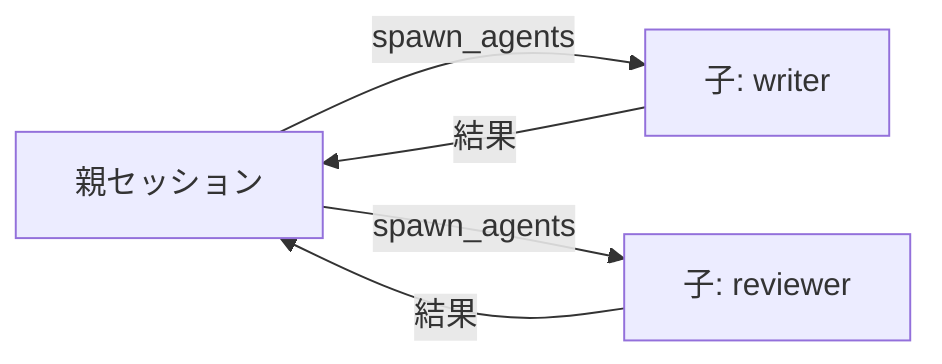
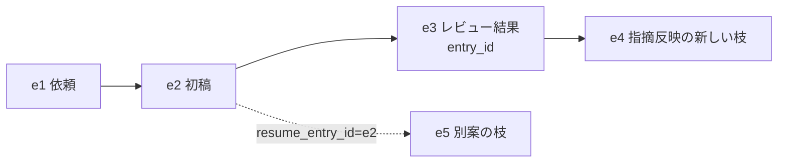

# pi-spawn

Pi から子エージェントを並列に起動する拡張です。子の作業は親の会話を汚さず、結果だけが親に戻ります。結果の `session_id` と `entry_id` を渡すと、子の作業を任意の地点から再開できます。

- **並列委譲**: 独立したサブタスクを複数の子へ同時に任せ、親は結果だけを受け取る
- **続きから再開**: 結果に含まれる `entry_id` を渡すと、その地点から子が続きを実行する（`/tree` で戻るのと同じ考え方）
- **進行の観測**: 実行中は子ごとの進捗を表示し、`/spawn` で子のログを追える

## インストール

| 項目 | 条件 |
|---|---|
| Pi | 1.0.3 で検証。他のバージョンは未検証 |
| Node.js | 22.19.0 以上 |

```bash
pi install git:github.com/kurowashi/pi-spawn
```

ref を固定する場合は `pi install git:github.com/kurowashi/pi-spawn@<tag|commit>` とします。ローカルの作業コピーからは `pi install /path/to/pi-spawn` でインストールします。インストール後は Pi を再起動してください。

## 使い方

### 1. 子の定義を作る

`~/.pi/agent/agents/reviewer.md` を作ります。

```markdown
---
name: reviewer
description: ドキュメントのレビュー役
---

あなたはレビュアーです。指摘は根拠とセットで返してください。
```

`name` が呼び出し名、`description` がモデルへの説明です。その他のキーは[子の定義](#子の定義)と [リファレンス](docs/reference.md#子の定義)を参照してください。

### 2. 子を起動する

モデルが必要と判断すると、次の形で `spawn_agents` を呼びます。

```text
spawn_agents({
  tasks: [
    { agent: "writer", task: "構成案を書いて", name: "outline" },
    { agent: "reviewer", task: "構成案をレビューして", name: "review" }
  ]
})
```

結果は run ごとに返ります。

```text
[outline] session_id=a1b2c3d4 entry_id=e5f6a7b8 (provider/id)
構成案の本文
```

## 設定

### 子の定義

定義は `agents/*.md` に書きます。frontmatter と本文で子の振る舞いを決めます。

| 場所 | 用途 |
|---|---|
| `<project>/.pi/agents/*.md` | プロジェクト固有。プロジェクトを trust したときだけ読む |
| `~/.pi/agent/agents/*.md` | 全プロジェクト共通 |

主なキーは次のとおりです。

| キー | 既定 | 意味 |
|---|---|---|
| `name` | 必須 | 呼び出し名 |
| `description` | 空 | 子を選ぶときにモデルへ渡す説明 |
| `tools` | Pi の既定 | 子が使えるツール |
| `model` | 親のモデル | 使うモデル（`provider/id`） |
| `inheritConversation` | `false` | `true` で親の現在の会話を複製して始める |
| `extensions` | `false` | `true` で子にも拡張を読み込み、子から `spawn_agents` を使えるようにする |

定義本文の `@path` は、子の起動時に参照先の内容を追加します。全キーと `@path` の規則は[リファレンス](docs/reference.md#子の定義)にあります。

### 制限時間

`spawn_agents` の1回の呼び出し全体に制限時間があります。既定は60分です。

```json
{ "timeoutMs": 3600000 }
```

- 設定は `~/.pi/agent/spawn.json`。trust 済みプロジェクトの `<cwd>/.pi/spawn.json` があれば、その値が優先されます
- `0` で無制限
- 時間切れの run は `timed out after <時間>` のエラーになり、完了済みの run の結果は残ります
- 現在の値は `/spawn status` で確認できます

## コマンド

| コマンド | 動作 |
|---|---|
| `/spawn` | 実行中の run から1件を選び、ログビューを開く |
| `/spawn <session_id>` | その run のログビューを開く |
| `/spawn status` | 制限時間の値と設定ファイルの場所を表示する |

ログビューの操作キーは[リファレンス](docs/reference.md#ログビュー)にあります。

## 仕組み

### 概要



| 用語 | 意味 |
|---|---|
| 親セッション | いまの Pi セッション。`spawn_agents` で子を起動し、全子の結果を受け取る |
| 子セッション | 親から委譲された1つのタスクを、子の定義に従って実行する。保存され、再開できる |
| run | 1つの子の1回の実行。結果は run ごとに返る |

`spawn_agents` は同期的なツール呼び出しです。全子が終わるまで親のターンは続きます。子をバックグラウンドで走らせることはできません。

### 続きから再開する

結果の `session_id` と `entry_id` を次の呼び出しに渡すと、その子の続きから実行します。

```text
spawn_agents({
  tasks: [{
    agent: "reviewer",
    task: "指摘を反映した版を再レビューして",
    resume_session_id: "a1b2c3d4",
    resume_entry_id: "e5f6a7b8"
  }]
})
```



- `entry_id` は、結果が終わった位置です。その位置から新しい枝を作って実行します
- 再開しても `session_id` は変わりません
- 再開した run の `usage` は、再開後に加算された分だけです
- 任意の地点から再開するには、子セッションの entry id を取り出します。entry id は JSONL の `id` にあります

```bash
jq -r 'select(.type == "message") | [.id, .message.role] | @tsv' <session_file>
```

`session_file` は結果に含まれます。再開のルールは[リファレンス](docs/reference.md#再開)にあります。

### 兄弟への連絡

同じ `spawn_agents` 呼び出しの子同士は、`message_agent` で直接連絡できます。宛先は `target_session_id` です。連絡は相手の新しいターンとして届き、返信は同じターン内では返りません。仕組みと宛先の一覧の形式は[リファレンス](docs/reference.md#兄弟へのメッセージ)にあります。

### ドキュメント

| 文書 | 読者と内容 |
|---|---|
| [docs/reference.md](docs/reference.md) | 利用者。全引数、定義の全キー、結果フィールド、再開の規則、ログビュー |
| [DESIGN.md](DESIGN.md) | 開発者。目的、達成状態、設計判断 |
| [AGENTS.md](AGENTS.md) | 変更するエージェントと開発者。壊してはいけない制約と検証 |

## 制限

| 制約 | 回避策 |
|---|---|
| バックグラウンド実行はできない。親は全子を待つ | 長い作業は分けて順に起動する |
| 子から親へ質問できない | タスク文に判断基準を書き、曖昧さは起動前に解消する |
| 親から実行中の子へ指示できない | 親のターンを中止する。子は中断され、結果にエラーとして残る |
| 委譲の深さは既定で1 | 多段委譲は、委譲する各階層の定義に `extensions: true` を書く |
| 並列に走る子の書き込みを隔離しない | 読み取り中心のタスクに限る |
| コストの上限を設けない | 結果の `usage` とセッション統計で確認する |
| 子の出力を自動で検証しない | 親がテストや差分を確認する |

## ライセンス

[MIT](LICENSE)
